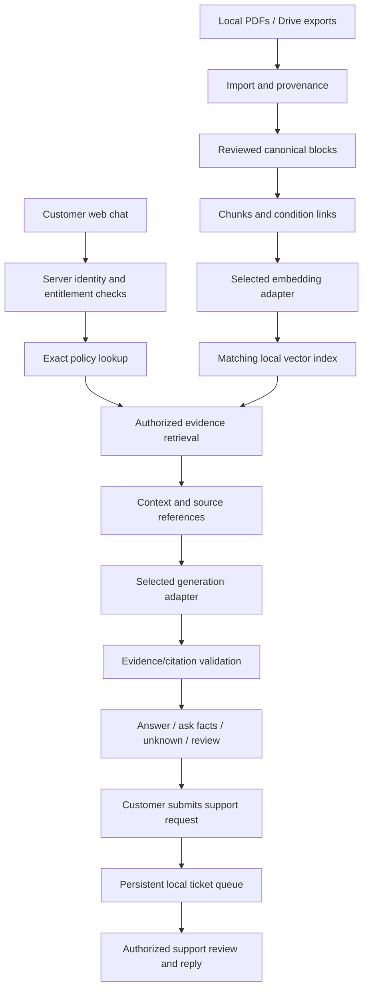

# Insurance RAG MVP specification

Version: 0.2.0 | Date: 2026-10-06 (Asia/Tokyo) | Status: Draft for review

Concrete implementation details: [Technical architecture and technology stack](../technical-design.md), mapped through [ADR-0013](../adr/0013-concrete-mvp-technology-stack.md). This document defines requirements; the technical design defines the recommended tools, modules, deployment, routes and storage boundaries.

## 1. Purpose and evidence status

Build a Python-first local learning application for UK/English mobile-device protection. Prospects compare products; existing customers ask about their exact policy; authorized customer-support employees review escalations. Both generation and embedding models are configurable for testing and evaluation. Extend through small, tested increments toward production.

This document specifies intended behavior, not completed software. Only the four source PDFs and their provenance manifest exist. There are no implemented application components, executable acceptance tests, model benchmarks, or live customer integrations. Proposed defaults below are not user-approved technology selections.

The workflow is specification-driven: requirements and examples precede implementation. Test-driven development (TDD) means writing a meaningful failing behavior test, implementing enough to pass, then refactoring while tests stay green. Architecture decision records (ADRs) preserve context, decisions, alternatives, and consequences. Sources: [Agile Alliance TDD](https://agilealliance.org/glossary/tdd/) and [AWS ADR guidance](https://docs.aws.amazon.com/prescriptive-guidance/latest/architectural-decision-records/introduction.html), checked 2026-10-06.

## 2. Confirmed scope and proposed defaults

Confirmed: Python first; local vector database; UK/English corpus; public policy PDFs plus synthetic customer data; local PDFs and Google Drive initially; interchangeable generation models; interchangeable embeddings for evaluation; access restrictions; cited evidence with unknown/uncertain-case escalation; comparison and upgrade exploration; incremental development.

Proposed defaults: Qwen3-Embedding-0.6B and BGE-small-en-v1.5 benchmark pair; clause-based child chunks with parent context and condition links; separate indexes per embedding configuration; SQLite for account/session/ticket records; a local asynchronous support queue. The concrete recommended stack is Streamlit, FastAPI/Pydantic, local containerized Qdrant, SQLite, pdfplumber/pypdf, Sentence Transformers, generation-provider adapters and pytest; see the technical design. These stack choices remain Proposed; no real generation model ID or identity provider has been selected.

Out of MVP: real claim approval, payment or purchase execution, automatic policy upgrades, real insurer ticket submissions, live agent staffing, real customer information, production single sign-on, and enforcing case-assigned-only support access. Design extension points now; do not claim these capabilities exist.

Google Drive scope: first support a user-exported file import with recorded Drive origin and explicit application permissions. An authenticated read-only connector is a later MVP increment, gated on account selection, authorization, and permission semantics. Manual import does not verify live Drive permissions or revocation propagation. Other connectors are post-MVP.

## 3. Actors and access matrix

| Actor | Public product corpus | Private policy/account data | Transcript/ticket access | Support workspace |
| --- | --- | --- | --- | --- |
| Prospect | Allowed | Denied | Own session and own submitted support request | Denied |
| Existing customer | Allowed | Own entitled records only | Own only | Denied |
| Authorized customer support | Allowed | All synthetic customers initially | All synthetic customer cases initially | Allowed |
| Other employee | Public information only | Denied | Own public session only | Denied |
| Ingestion administrator | Import/configuration scope | No implicit customer-support entitlement | No implicit entitlement | Denied unless separately authorized |

Unknown identity or missing permission metadata denies private access. Role and ownership are resolved server-side. A request-supplied customer ID or chat session ID is not authorization. Prototype identities are synthetic server-controlled fixtures, explicitly labelled as simulation; they must not be described as production authentication.

## 4. Functional requirements

Every MUST below is an intended acceptance requirement. Traceability is in section 8 and [traceability.json](traceability.json).

| ID | Required behavior | Planned tests |
| --- | --- | --- |
| FR-01 | Import supported local PDFs; preserve immutable originals, SHA-256 provenance, source/version metadata, and synthetic-data labels. Reject/quarantine failed extraction rather than mark it indexed. | T-01, T-02, T-03 |
| FR-02 | Import Drive-exported PDFs with origin and explicit application permissions; expose a future connector contract without implying live permission sync. | T-04 |
| FR-03 | Preserve headings, clauses, table labels, reading order, and page/span citations in canonical extracted blocks. | T-05, T-06 |
| FR-04 | Produce coherent chunks without mixing product/version boundaries or silently truncating input. Split oversized clauses at meaningful boundaries. | T-07, T-08 |
| FR-05 | Link searchable clauses to parent sections and relevant conditions/exclusions, using exact product/version scope and provenance. | T-09, T-10 |
| FR-06 | Enforce access on search, record lookup, citations, transcripts, tickets, caches, and support actions; apply identical checks under every model. | T-11, T-12, T-13 |
| FR-07 | Resolve the customer's exact policy, version, dates, and administrator from authoritative synthetic account records; never infer ownership from vector similarity. | T-14, T-15 |
| FR-08 | Provide replaceable embedding adapters with distinct document/query encoding and model-owned prompt/tokenization requirements. | T-16, T-17 |
| FR-09 | Select a compatible built index; reject mismatches or missing indexes; namespace caches by complete embedding/index configuration. | T-18, T-19, T-20 |
| FR-10 | Retrieve authorized evidence, expand linked conditions, deduplicate evidence, and retain source provenance. Comparison requests retrieve each permitted product independently. | T-21, T-22, T-23 |
| FR-11 | Provide replaceable generation adapters with common request/response contracts, declared capabilities, and explicit failure behavior. | T-24, T-25 |
| FR-12 | Produce grounded explanations, ask for missing facts, abstain on insufficient/conflicting evidence, validate citations, and treat source instructions as untrusted data. | T-26, T-27, T-28, T-29, T-30 |
| FR-13 | Compare documented benefits, exclusions, and conditions without inventing prices or upgrade eligibility; distinguish comparison from enrollment or claim approval. | T-31, T-32 |
| FR-14 | On explicit customer submission, persist a support request and evidence references; allow authorized support to review/respond; show owned status and prevent duplicate submissions. | T-33, T-34, T-35, T-36, T-37 |
| FR-15 | Run local application/storage with configurable providers and disabled-by-default network-dependent tests; preserve modular extension points. | T-41, T-42, T-43 |
| FR-16 | Run reproducible, labelled embedding/chunking/answer evaluations and report measured evidence separately from mocks and unrun checks. | T-38, T-39, T-40 |

## 5. Intended architecture and contracts

Adapters are Python interfaces translating common application operations into backend-specific calls. The following are proposed contracts, not existing APIs:

| Contract | Minimum fields/operations and invariants |
| --- | --- |
| Document | ID, checksum, original path, source URI, product ID, policy version, jurisdiction, type, permission class, import status. Missing policy-version mapping prevents personalized interpretation. |
| SourceBlock | Block ID, document ID, heading path, original text, table/row relationship, source spans. Multi-page blocks retain all contributing spans. |
| Chunk | Stable ID, document/version, parent ID, text, heading path, page/spans, related condition IDs, permissions. No cross-version merging. |
| PolicyAccount | Synthetic customer ID, exact policy document/version reference, start/end dates, administrator, fictional certificate fields and entitlement. Synthetic values are never represented as insurer facts. |
| EmbeddingAdapter | Encode documents, encode queries, count input tokens, report capabilities/configuration. Adapter owns required prompts and tokenizer; outputs must match index dimensions. |
| IndexManifest | Corpus/chunk hashes; model ID/revision; tokenizer, preprocessing, prompt and adapter versions; dimensions; normalization; similarity metric; build status. Identity is derived from configuration, not a display name. |
| RetrievalRequest/Result | Verified principal, permitted policy scope, query, selected index and limits; evidence IDs/text/source spans plus retrieval configuration. Raw similarity is not coverage confidence. |
| GenerationAdapter | Generate from query, conversation and bounded evidence; declare context/structured-output capabilities; return answer/status/citation references or typed failure. Unsupported capabilities fail explicitly. |
| Answer | Status: ANSWERED, NEEDS_FACTS, UNKNOWN, REVIEW_REQUIRED or SERVICE_ERROR; text, verified citations, missing facts and optional support offer. Operational failure is not presented as lack of policy knowledge. |
| SupportTicket | Ticket/customer/session IDs, request type, original transcript/evidence references, policy/version, uncertainty reason, status, submission key, timestamps and staff replies. An AI summary cannot replace the original record. |
| EvaluationRun | Run ID, complete configurations, dataset/labels revision, timings, per-query retrieved evidence, results, failures, environment and checks-run status. |

Private-data access checks also apply to parent/context expansion. Cached authorization must not outlive changed permissions. Experimental index selection never changes user entitlement. Rebuilds create new indexes; partial builds are not selectable. Prototype storage binds to localhost and uses local persistent directories; generation/embedding adapters may contact external providers only when explicitly configured.

## 6. Proposed retrieval, chunking, and grounding behavior

Initial chunking target: 250-450 tokens, with approximately 600-token maximum including headings. Complete clauses have no overlap; split clauses may repeat 40-60 tokens. These are tuneable starting values, not measured optima. Model-specific token limits override these defaults. Embedding-only comparisons use common chunks that fit all candidates, including headings/prompts; do not silently truncate BGE's shorter input.

Use full policy wording for personal coverage interpretation. Product summaries support discovery and comparisons but do not replace detailed wording or account/certificate facts. Preserve conflicts rather than silently resolve them by document length or retrieval score.

For personalized queries: resolve entitlement and exact policy/version, retrieve candidates, expand required linked conditions/exclusions within scope, construct a bounded evidence set, generate, and validate evidence references. Missing a required condition produces uncertainty or additional retrieval, not unconditional coverage. A matching benefit plus an exclusion is not a formal adjudication.

A chunk link is a reviewed relationship, not a generated legal conclusion. Parent expansion alone cannot discover conditions in distant sections. The initial four-document corpus permits manually reviewed relationships; later automation must retain review and regression checks.

Working example: Care+ wording PDF page 3 describes the battery benefit, while PDF page 6 limits battery replacement under the policy to after manufacturer warranty expiry. A query about a battery at 75% with unknown warranty status requires both source references and a warranty-status question. Fixture assertions check retrieved evidence IDs and behavior, not exact answer wording. See [source corpus](../../data/reference/mobile_protection_uk/README.md).

## 7. Support behavior

Proposed asynchronous local queue: OPEN -> IN_PROGRESS -> WAITING_FOR_CUSTOMER -> RESOLVED, with direct IN_PROGRESS -> RESOLVED allowed and WAITING_FOR_CUSTOMER -> IN_PROGRESS when new information arrives. Reopening is a later decision. Invalid transitions fail. The customer sees only owned tickets/replies. Support can review all synthetic customers initially; non-support employees cannot.

Abstention offers help without creating a ticket automatically. Submission preserves original evidence and is idempotent: repeat submission of the same request returns the existing ticket instead of duplicating it. Confirmation is shown only after durable persistence. Service errors show retry/help options; they are not automatically treated as insurance questions.

Samsung's public contact/claim/complaint routes are reference information. Our queue is neither a Samsung integration nor an insurance claim. Any future case-specific support grant must include verified staff assignment, scope, expiry/revocation, and access history; a session ID is insufficient.

## 8. Design-plan to ADR to test mapping

| Design plan | Scope | ADR | Requirements | Planned tests |
| --- | --- | --- | --- | --- |
| DP-01 | Specification, ADR and TDD governance | [ADR-0001](../adr/0001-specification-and-test-first-delivery.md) | FR-01-FR-16 | All T-01-T-43 |
| DP-02 | Python/local modular application | [ADR-0002](../adr/0002-python-local-modular-boundaries.md) | FR-11, FR-15 | T-24, T-25, T-41, T-42, T-43 |
| DP-03 | Corpus, provenance and Drive ingestion | [ADR-0003](../adr/0003-source-provenance-and-synthetic-data.md) | FR-01, FR-02 | T-01, T-02, T-03, T-04 |
| DP-04 | Identity, entitlement and exact policy lookup | [ADR-0004](../adr/0004-server-enforced-access-and-policy-identity.md) | FR-06, FR-07 | T-11, T-12, T-13, T-14, T-15 |
| DP-05 | Structure-aware chunks and condition links | [ADR-0005](../adr/0005-clause-chunks-and-linked-conditions.md) | FR-03, FR-04, FR-05 | T-05, T-06, T-07, T-08, T-09, T-10 |
| DP-06 | Swappable embeddings and isolated indexes | [ADR-0006](../adr/0006-embedding-adapters-and-isolated-indexes.md) | FR-08, FR-09 | T-16, T-17, T-18, T-19, T-20 |
| DP-07 | Scoped retrieval and evidence expansion | [ADR-0007](../adr/0007-scoped-evidence-retrieval.md) | FR-10 | T-21, T-22, T-23 |
| DP-08 | Swappable answer generation | [ADR-0008](../adr/0008-generation-provider-adapters.md) | FR-11 | T-24, T-25 |
| DP-09 | Grounded answers, comparison and abstention | [ADR-0009](../adr/0009-grounding-comparison-and-abstention.md) | FR-12, FR-13 | T-26, T-27, T-28, T-29, T-30, T-31, T-32 |
| DP-10 | Persistent support handoff | [ADR-0010](../adr/0010-local-support-queue.md) | FR-14 | T-33, T-34, T-35, T-36, T-37 |
| DP-11 | Controlled model-quality evaluation | [ADR-0011](../adr/0011-controlled-retrieval-and-answer-evaluation.md) | FR-16 | T-38, T-39, T-40 |
| DP-12 | Local records and future production migration | [ADR-0012](../adr/0012-local-record-storage-and-extension-path.md) | FR-06, FR-14, FR-15 | T-13, T-34, T-35, T-36, T-41, T-42, T-43 |
| DP-13 | Concrete technology stack and implementation boundaries | [ADR-0013](../adr/0013-concrete-mvp-technology-stack.md) | FR-01, FR-03, FR-06, FR-08, FR-09, FR-11, FR-14, FR-15, FR-16 | T-01-T-03, T-05-T-06, T-11-T-13, T-16-T-20, T-24-T-25, T-33-T-43 |

## 9. Incremental implementation plan

Each increment begins with its acceptance examples and a failing behavior test. Test names and commands are defined only when actual tests/tooling exist; see [TDD plan](../testing/mvp-test-plan.md).

| Increment | Deliverable and gate | Design plans |
| --- | --- | --- |
| P-01 | Adopt/revise the concrete recommended stack; verify runtime/container dependencies; define contracts and synthetic identity/account fixtures; test ownership and denied access first. | DP-01, DP-02, DP-04, DP-12, DP-13 |
| P-02 | Import the four PDFs, review extraction and clause/condition links, and retain provenance. Gate: no missing spans or cross-version chunks in reviewed fixtures. | DP-03, DP-05 |
| P-03 | Implement two embedding adapters and persistent local indexes. Gate: correct model/index binding, reproducible builds and no silent truncation. | DP-06, DP-07 |
| P-04 | Implement replaceable generation, citations, abstention and comparison. Gate: access and grounding regressions pass with deterministic fixtures; run separately labelled real-provider checks. | DP-08, DP-09 |
| P-05 | Add customer web chat and support queue/replies. Gate: owned access, restart persistence, valid transitions and duplicate prevention. | DP-02, DP-04, DP-10, DP-12 |
| P-06 | Add Drive-export import; optionally authorize/implement read-only Drive connector. Gate: accurate provenance and explicit permission model; live sync claims require live evidence. | DP-03, DP-04 |
| P-07 | Run embedding and chunking experiments; freeze selected default/configuration. Gate: publish actual results and limitations, not leaderboard claims. | DP-06, DP-11 |

Post-MVP: real identity, assigned-case support grants, managed support/claims integrations, live handoff, revocation synchronization, additional sources, deployment reliability, operational monitoring and jurisdiction review. Each extension needs its own spec change, ADR and acceptance tests before implementation.

## 10. Acceptance and evidence gates

- All relevant deterministic contract/access/persistence tests pass. Planned negative-access cases must show zero unauthorized content, citations or replies; this does not prove all security properties.
- All four PDFs reconcile against the source manifest; extraction/structure and condition links are reviewed before indexing.
- Both initial embedding adapters build and query their own matching indexes using an unchanged labelled corpus snapshot.
- The battery cross-section fixture retrieves both required source references and asks for missing warranty facts.
- Unsupported questions abstain in fixtures and are evaluated separately with real generation models. Citation existence checks do not establish that every answer claim is supported; human-labelled answer review is required.
- Support submission/reply works across application restarts without duplicate tickets or cross-customer access.
- Publish approximately 40 labelled evaluation questions with expected evidence IDs, exclusions/conditions and answerability. Reserve a held-out subset before tuning; never assert an unmeasured quality percentage.
- Record retrieval recall at k (fraction of labelled evidence retrieved), all-required-evidence success, answer support/citation correctness, false coverage assertions, latency, memory and indexing cost/time. Separate model loading, warm queries and generation time.
- Live model/API tests are opt-in and may be billable. Offline/mock success does not verify a provider or production readiness.
- No numerical production latency, concurrency or accuracy target is accepted yet. Collect baseline measurements, then propose explicit targets through an ADR/spec revision.

## 11. Open decisions and change control

Open: adoption/revision of the concrete stack proposed in the technical design, verified package/container locks, real generation model IDs and configured provider(s), actual local model latency/memory, permission semantics of a future Drive connector, escalation queue acceptance, and quantitative quality/performance targets. Proposed choices must not be recorded as accepted merely because this document exists.

For every feature/change: update or add requirement IDs and acceptance examples; add an ADR or mark the old ADR superseded without deleting history; update traceability; write a meaningful failing test; implement/refactor; run appropriate checks; record actual evidence. Do not change gold labels just to make a failing model pass. Intentional label corrections require a reviewed dataset revision and rerun.

## 12. References

- [Source manifest](../../data/reference/mobile_protection_uk/source-manifest.json) and [corpus notes](../../data/reference/mobile_protection_uk/README.md): local evidence, downloaded 2026-10-06.
- [Qwen embedding model card](https://huggingface.co/Qwen/Qwen3-Embedding-0.6B), [BGE model card](https://huggingface.co/BAAI/bge-small-en-v1.5), [Sentence Transformers retrieval](https://www.sbert.net/examples/sentence_transformer/applications/semantic-search/README.html): candidate model integration references.
- [Structure-aware chunking](https://learn.microsoft.com/en-us/azure/architecture/ai-ml/guide/rag/rag-chunking-phase), [embedding migration](https://qdrant.tech/documentation/tutorials-operations/embedding-model-migration/): design references, not selection of those vendors.
- [Samsung UK policy/claim routing](https://www.samsung.com/uk/support/repair/) and [Care+ public portal](https://uk.careplus.co/): verified public process; internal AI handoff remains unverified.
