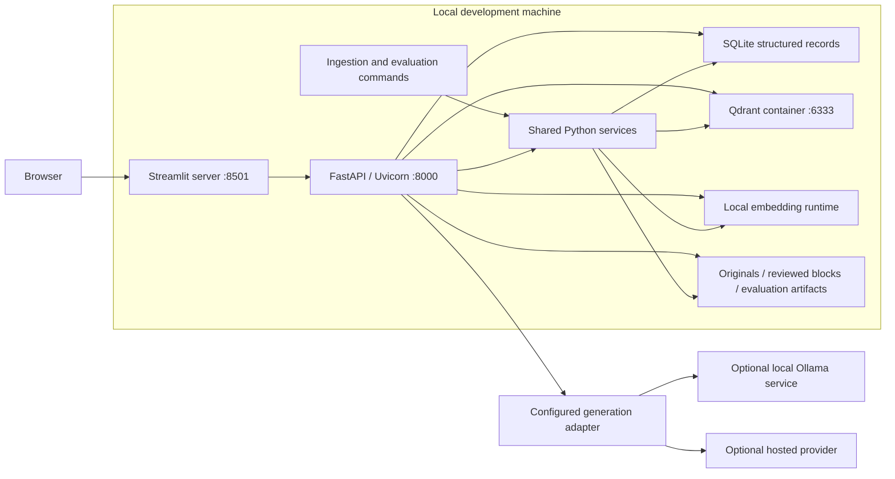

# Technical architecture and technology stack

Version: 0.2.0 | Date: 2026-10-06 | Status: Proposed implementation design

Related: [MVP specification](specs/insurance-rag-mvp.md), [stack ADR](adr/0013-concrete-mvp-technology-stack.md), [TDD plan](testing/mvp-test-plan.md).

This document supplies the concrete stack missing from the first specification. Tool choices are recommendations, not installed dependencies or verified application behavior. Existing artifacts remain the source corpus and design documents. Exact dependency versions and generation model IDs must be selected and compatibility-tested during scaffolding.

## 1. Recommended stack and alternatives

| Layer | Recommendation | What it does and why it fits | Alternative / tradeoff |
| --- | --- | --- | --- |
| Runtime | Python 3.12 baseline, project-isolated environment | One language for UI, backend, ingestion, models and tests. Proposed compatibility baseline; do not assume every package/model is verified. | A newer supported Python is possible after dependency checks. |
| Customer/support UI | Streamlit | Python-built chat, account demo, citation view, ticket queue and experiment views; suits Python-first learning. | React/Next.js gives more frontend control but adds a JavaScript stack. Streamlit is not the production frontend decision. |
| Backend API | FastAPI with Uvicorn | API = application programming interface; backend owns request validation, identity checks and application workflows. Uvicorn runs the Python web service. | Direct Streamlit service calls reduce processes but couple UI execution to core workflows; Flask is viable with more explicit schema plumbing. |
| Data contracts | Pydantic models | Validate typed requests, responses, manifests and configuration. FastAPI supports these models and OpenAPI documentation. Schema validity does not establish factual correctness. | Plain dataclasses need separate validation; a broad agent framework is unnecessary here. |
| Vector database | Qdrant server in a local Docker container; qdrant-client in Python | A collection is a stored group of vectors and metadata. One collection per complete embedding/chunk/corpus configuration; payload filters help implement scoped retrieval. | Embedded Qdrant avoids Docker but couples storage lifetime/ownership to a Python process. Chroma is another local candidate; PostgreSQL with pgvector becomes attractive if relational/vector operations are intentionally consolidated. No ranking claim is made. |
| Account/session/ticket store | SQLite through Python's sqlite3 and repository interfaces | Exact lookup and transactional state, distinct from similarity search. Parameterized SQL and numbered schema migrations. | SQLAlchemy/Alembic add an ORM and migration framework; defer until useful. PostgreSQL is a migration candidate for measured production concurrency needs. |
| PDF extraction | pdfplumber with page geometry/table extraction; pypdf for PDF validation/metadata | Preserve source spans, headings, table-row relationships and columns; review normalized blocks before indexing. | Docling or hosted layout/OCR tools can be evaluated when scanned/complex sources are introduced. Current corpus does not justify a mandatory OCR service. |
| Chunking | Small custom structural chunker | Deterministic clause boundaries, parent sections and explicit condition links; model-tokenizer length checks. | A recursive splitter is a baseline/fallback for long sections, not the authority for policy relationships. |
| Local embeddings | Sentence Transformers, Transformers and PyTorch behind EmbeddingAdapter | Run Qwen3-Embedding-0.6B and BGE-small-en-v1.5 with model-specific query/document encoding. | Hosted embedding SDKs can implement the same interface later. Hardware acceleration is opt-in after correctness/runtime checks. |
| Generation | GenerationAdapter with deterministic fake plus proposed Ollama and Anthropic adapters | Fake for offline TDD; Ollama HTTP API for a real local option; official Anthropic SDK for a hosted option. Actual model IDs and which real adapter to run remain explicit configuration choices. | Other provider SDKs can be added without changing business logic. A universal gateway adds a dependency and does not erase capability differences. |
| HTTP calls | HTTPX | Streamlit server calls FastAPI; local model adapter calls an HTTP service. HTTP is the request/response protocol connecting processes. | Provider SDKs handle their own transport; do not force all providers into an identical wire protocol. |
| Tests | pytest, FastAPI TestClient and Streamlit AppTest | Fixtures and parameterized checks for domain logic, adapter contracts, API authorization, UI behavior and local persistence. | Browser automation is added only for journeys not covered meaningfully by component tests. |
| Evaluation | A small Python evaluation runner, JSONL per-query records and summary JSON/CSV | Separate retrieval completeness, answer review and timing; reproducible configurations and human-reviewed labels. | Ragas or other evaluator packages can be investigated later; an LLM judge is not the only oracle. |
| Logs/configuration | Python logging; Pydantic configuration loaded from file/environment | Structured request/run IDs, adapter selection, index identity, timing and error codes. Secrets stay outside committed config. | Distributed telemetry and a secret manager belong to deployment requirements, not the learning baseline. |

Official capabilities checked 2026-10-06: [Streamlit architecture](https://docs.streamlit.io/develop/concepts/architecture/architecture), [FastAPI features](https://fastapi.tiangolo.com/features/), [Qdrant local setup](https://qdrant.tech/documentation/quickstart/), [SQLite deployment tradeoffs](https://www.sqlite.org/whentouse.html), [pdfplumber](https://github.com/jsvine/pdfplumber), [pytest fixtures](https://docs.pytest.org/en/stable/how-to/fixtures.html), [Ollama API](https://docs.ollama.com/api/introduction), [Anthropic SDKs](https://platform.claude.com/docs/en/cli-sdks-libraries/overview). These references establish capabilities, not tested compatibility of this proposed package combination.

## 2. Local deployment topology

Proposed ports are configuration defaults, not running services. Bind Streamlit, FastAPI and published Qdrant ports to 127.0.0.1, not all network interfaces. The browser communicates with Streamlit; Streamlit's server calls FastAPI. UI code never queries Qdrant/SQLite directly. Docker is the container runtime used to run Qdrant as a separate process. Qdrant's local quickstart documents port 6333; its default instance has no authentication, so network binding is part of this prototype design, not a substitute for production database security.

Use one API process and serialized ingestion/model-evaluation jobs initially. Keep expensive embedding/model work outside the web event loop; no distributed worker queue, Redis or Celery is required. A command process shares service code and configuration but opens its own database connections. Do not share live SQLite connections between processes or hold a database transaction during a model/API call.

## 3. Dependency direction and planned source layout

The domain layer depends on contracts; services depend on domain rules and adapter interfaces; concrete adapters depend on vendor libraries. API/UI modules depend on services/contracts. Domain rules do not import Streamlit, FastAPI, Qdrant or a provider SDK.

Planned paths below are a proposed layout, not files already created:

| Path | Responsibility |
| --- | --- |
| src/insurance_rag/domain/ | Principal/entitlement rules, exact policy resolution, ticket transitions, answer states |
| src/insurance_rag/contracts/ | Pydantic Document, Chunk, IndexManifest, evidence, Answer and Ticket schemas |
| src/insurance_rag/services/ | Ingestion, index building, retrieval/context assembly, chat, support and evaluations |
| src/insurance_rag/ports/ | EmbeddingAdapter, GenerationAdapter, VectorStore, RecordStore, SourceConnector and SupportSink interfaces |
| src/insurance_rag/adapters/ | Sentence Transformers, provider clients, Qdrant, SQLite and PDF/source implementations |
| src/insurance_rag/api/ | FastAPI routes, verified principal resolution, error translation and application startup |
| src/insurance_rag/ui/ | Streamlit customer chat, support queue and developer experiment views |
| src/insurance_rag/cli/ | Explicit ingestion/build/evaluation entry points using shared service code |
| tests/unit/, tests/contracts/, tests/integration/, tests/acceptance/ | Deterministic behavior/contract/local persistence/API/UI tests |
| tests/model_integration/ | Opt-in local-model and hosted-provider checks |
| data/reference/ | Preserved original documents and source manifests |
| data/processed/, data/evaluation/ | Reviewed canonical blocks/chunks/links and labelled question datasets |
| var/app.sqlite, var/qdrant/, var/runs/ | Generated persistent state/index storage/evaluation outputs; excluded from source control |

Construct adapters once through an application composition root (startup factory). Dependency injection means supplying the selected implementations instead of hard-coding vendor calls in business logic. Tests supply fakes through the same interfaces.

## 4. Source ingestion and index lifecycle

1. Import a local PDF or Drive-exported PDF under an ingestion-admin scope; preserve bytes/checksum and record explicit application permissions. No account/role guesses from filenames.
2. Extract geometric blocks/table rows and source spans. Review the two-column summaries and cross-page clauses. Persist reviewed blocks before chunking.
3. Create deterministic chunks, parent references and reviewed condition/exclusion links. The same canonical chunks are available to different embedding runs.
4. Resolve the embedding configuration; verify every full input fits its tokenizer limit. Embedding-only experiments use common inputs that fit all candidates.
5. Build into a new Qdrant collection with index identity derived from corpus hash, chunking hash and complete embedding configuration. Persist build state in SQLite and write an index manifest.
6. Validate count/content references/dimensions/configuration, then mark READY. Partially built collections are not selected. Reimport or rebuild never silently replaces an active ready collection.
7. On failed/interrupted build, mark FAILED or interrupted before reuse, retain a diagnostic reference, and require a controlled rebuild/recovery. Do not report indexing success from extraction alone.

Google Drive export is the first source mode. A future live connector implements SourceConnector, uses explicit read authorization and carries source sharing/version semantics. No live OAuth or revocation behavior is implemented or implied here.

## 5. Query and comparison data flow

1. FastAPI resolves an opaque synthetic session token to a server-owned fixture principal. Demo bootstrap is local-only and explicitly labelled simulated identity; roles/customer IDs in query bodies are not trusted.
2. For a personal policy question, RecordStore resolves the exact entitled policy/version and relevant account facts. Prospects use public product scope; comparisons establish each permitted product scope independently.
3. Select a READY index and verify encoder/manifest identity. Encode the question using that adapter's query prompt. Changing the UI model selector cannot change entitlement.
4. Qdrant searches permitted product/version/document scopes. Services also validate returned metadata before expanding parents/condition links; vector filtering alone is not the authorization authority.
5. Assemble bounded evidence with deduplicated source references. If required evidence is missing, retrieve targeted linked clauses or return an uncertainty state. Parent expansion cannot bypass ownership.
6. The configured GenerationAdapter receives only allowed context and required account facts. External providers receive no API keys in prompts; the adapter owns credentials and transport.
7. Validate structured answer/citation references, record the allowed result, and return ANSWERED, NEEDS_FACTS, UNKNOWN, REVIEW_REQUIRED or SERVICE_ERROR. Structural checks are not semantic correctness guarantees; labelled model evaluations remain required.

Initial retrieval limits are configurable and must be reported with each run. Do not invent a universal similarity threshold. Search ranking and condition expansion must be benchmarked independently of the generation model.

## 6. Proposed backend route contract

These are application API proposals, not Samsung/provider endpoints or implemented routes. HTTP GET reads; POST submits a command or creates a resource. Requests/responses are JSON unless a document stream is returned.

| Route | Actor and behavior | Main tests |
| --- | --- | --- |
| GET /health | Local health; no private source/configuration output | T-41 |
| GET /v1/policies | Public permitted product metadata; no customer records | T-11, T-14 |
| GET /v1/me/policies | Verified existing customer; exact owned policy references | T-12, T-14, T-15 |
| POST /v1/chat/sessions | Create a session owned by the verified principal | T-11, T-12 |
| POST /v1/chat/sessions/{id}/messages | Check ownership; submit question and permitted READY index/generation profile; persist/return answer and citations | T-13, T-18, T-21, T-24-T-30 |
| GET /v1/evidence/{id} | Recheck source entitlement; return cited source snippet/page reference, never arbitrary filesystem paths | T-10, T-13, T-28 |
| POST /v1/support/tickets | Customer submits owned session reference and submission key; bind actor and preserve evidence server-side | T-33, T-34, T-35 |
| GET /v1/support/tickets | Customer sees own; authorized support sees synthetic prototype queue; ordinary employee denied | T-13, T-36 |
| POST /v1/support/tickets/{id}/replies | Entitled customer/support reply; role controls status transitions | T-36, T-37 |
| POST /v1/admin/imports | Ingestion-admin command with provenance/permission mapping | T-01-T-04, T-11 |
| POST /v1/admin/index-builds | Ingestion-admin initiates tracked build; expose readiness only after validation | T-17-T-20 |
| POST /v1/admin/evaluation-runs | Developer evaluation scope; explicit configuration and network/billing opt-in | T-38-T-43 |

Typical HTTP errors: 401 invalid/missing identity; 403 forbidden operation; 404 absent or inaccessible private resource where concealment is appropriate; 409 conflicting/not-ready configuration or invalid ticket transition; 422 invalid request; 503 dependency unavailable. Business UNKNOWN/NEEDS_FACTS responses are distinct from transport/service failures. No query body can override the verified principal.

MVP chat returns a complete answer rather than streaming. Streaming is a later feature because partially displayed answers need an explicit citation-validation policy. UI retries use the same submission key; Streamlit reruns must not create duplicate chat/support commands.

## 7. Structured storage and transaction boundaries

Proposed SQLite tables: principals, entitlements, policy_accounts, documents, source_blocks, chunks, condition_links, index_builds, chat_sessions, messages, answer_evidence, support_tickets, ticket_events, evaluation_runs and schema_migrations. Table design is finalized with tests before schema creation.

Ownable tables carry principal/customer references; references have explicit foreign keys. Private content checks use the current verified principal and service-level entitlement rules. Customer-specific values are synthetic fixtures, not inferred from public PDFs.

Use unique submission keys scoped to the actor/operation for ticket deduplication. Persist ticket and initial event in one transaction; return confirmation after commit. Durable message handling assigns a request ID and pending/result state; a generation call is not held inside a SQLite transaction. Retry behavior must distinguish pending, completed and failed requests.

Qdrant stores chunk vectors and scoped metadata; reviewed original text/spans remain reconstructable in the canonical store. Do not make vector results the source of truth for account ownership, identity or ticket state. Selecting an embedding profile selects its corresponding collection; the SQLite index manifest is also validated.

## 8. Configuration and provider boundaries

Configuration groups: runtime paths/ports; vector backend; record store; source imports; chunking; named embedding profiles; named generation profiles; retrieval/context limits; support; evaluation. Use Pydantic validation and fail explicitly on missing or conflicting configurations.

An embedding profile specifies model ID/revision, prompts, tokenizer, dimensions, normalization and device settings. A generation profile specifies provider, explicit model ID, context/output capabilities, limits/timeouts and a secret reference. Secret values are environment configuration outside committed files, not experiment labels or request logs.

Model selectors reference allowlisted server configuration; users do not supply arbitrary provider URLs, model paths or source locations. Download/build and external API execution are explicit actions, not automatic startup side effects. Provider fallbacks are disabled unless a tested, recorded fallback policy is selected.

Ollama and Anthropic are proposed first real generation adapters to demonstrate independent backend implementations. A fake adapter is the default only for offline tests; the app must visibly indicate simulation and cannot present it as a real model evaluation. Real provider interchangeability requires real-adapter contract evidence; successful fake switching does not establish it.

## 9. Test and evaluation implementation

Use pytest fixtures for actors, source blocks, tokenizers and deterministic generation outputs. Parameterize shared adapter contracts across implementations; use temporary SQLite and isolated Qdrant test collections. FastAPI TestClient validates API behavior and dependency overrides. Streamlit AppTest exercises role-specific screens and rerun/submission behavior; backend authorization remains separately tested.

The default suite is offline and excludes model downloads/external requests. Separate opt-in groups cover real local model encoding, the containerized database and hosted generation calls. Record environment, setup, tests executed, failures and skips. All 43 tests remain planned, not implemented.

Run labelled retrieval evaluation before answer evaluation. For embedding comparisons, identical canonical fitting chunks and search parameters are required; for chunking comparisons, embeddings are fixed. Keep generation/prompt fixed for end-to-end answer comparisons. Measure cold loading, warm query encoding, vector search, evidence expansion and generation separately. No throughput, memory or quality value has been measured for this stack.

## 10. Design traceability and production extension

| Existing design plan | Technical realization | ADR |
| --- | --- | --- |
| DP-01 | Versioned spec, pytest workflow, recorded checks | [ADR-0001](adr/0001-specification-and-test-first-delivery.md) |
| DP-02 | Streamlit -> FastAPI -> shared Python services/ports | [ADR-0002](adr/0002-python-local-modular-boundaries.md) |
| DP-03 | pdfplumber/pypdf, source manifests, Drive-export importer | [ADR-0003](adr/0003-source-provenance-and-synthetic-data.md) |
| DP-04 | Server session/principal dependencies, entitlement services, exact SQLite lookup | [ADR-0004](adr/0004-server-enforced-access-and-policy-identity.md) |
| DP-05 | Deterministic structural chunker and reviewed SQLite condition links | [ADR-0005](adr/0005-clause-chunks-and-linked-conditions.md) |
| DP-06 | Sentence Transformers adapters and isolated Qdrant collections/manifests | [ADR-0006](adr/0006-embedding-adapters-and-isolated-indexes.md) |
| DP-07 | Qdrant scoped queries plus service-level evidence expansion | [ADR-0007](adr/0007-scoped-evidence-retrieval.md) |
| DP-08 | Fake/Ollama/Anthropic GenerationAdapter implementations | [ADR-0008](adr/0008-generation-provider-adapters.md) |
| DP-09 | Typed answer states, evidence validation, labelled reviews | [ADR-0009](adr/0009-grounding-comparison-and-abstention.md) |
| DP-10 | SQLite ticket service and Streamlit support/customer views | [ADR-0010](adr/0010-local-support-queue.md) |
| DP-11 | Python evaluation runner and versioned JSONL/JSON/CSV records | [ADR-0011](adr/0011-controlled-retrieval-and-answer-evaluation.md) |
| DP-12 | sqlite3 repositories, transactions, migration history and replaceable SupportSink | [ADR-0012](adr/0012-local-record-storage-and-extension-path.md) |
| DP-13 | Concrete stack, deployment, routes and module boundaries in this document | [ADR-0013](adr/0013-concrete-mvp-technology-stack.md) |

Production changes are future design work: replace simulated identity with a real identity provider, restrict support to assigned/revocable cases, evaluate PostgreSQL and managed/containerized Qdrant operations, replace Streamlit if customer UX demands it, integrate a real case system, add reliable external delivery and operational telemetry. Each change needs measured requirements, a new or superseding ADR and acceptance examples; these are not guaranteed drop-in upgrades.

## 11. Scaffolding gate

Before writing implementation: adopt or revise this proposed stack; verify local container availability and Python/model dependency compatibility; select explicit real generation model IDs and opt-in provider behavior; generate reproducible package/container locks; create the first behavior tests. Do not use unpinned container latest tags as the eventual reproducible build. No packages, containers, models, services or external integrations were installed or started to write this design.
